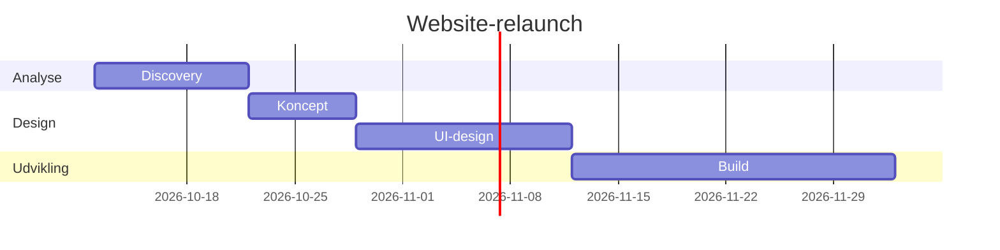
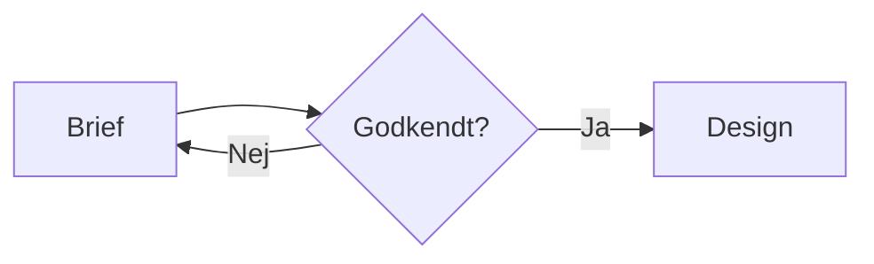

# Demo: diagrammer og charts

Almindelig markdown står som tekst. Blokkene nedenfor renderes, og koden kommer frem, når du klikker **Redigér** på blokken.

## Tidsplan



## Flow



## Status

Budgettet er brugt 82 % efter fire uger, og uge 44 ligger over budget.

```html
<style>
  .kpis { display: grid; grid-template-columns: repeat(auto-fit, minmax(160px, 1fr)); gap: 12px; }
  .kpi { background: var(--color-card); border: 1px solid var(--color-border); border-radius: 10px; padding: 14px 16px; }
  .kpi small { display: block; color: var(--color-secondary-foreground); font-size: 13px; }
  .kpi strong { font-size: 28px; }
</style>
<div class="kpis">
  <div class="kpi"><small>Timer brugt</small><strong>156</strong></div>
  <div class="kpi"><small>Budget brugt</small><strong style="color: var(--color-primary)">82 %</strong></div>
  <div class="kpi"><small>Deadline</small><strong>14. nov.</strong></div>
</div>
```

```html
<div style="position:relative;height:260px">
  <canvas id="timer"></canvas>
</div>
<script>
  new Chart(timer, {
    type: 'bar',
    data: {
      labels: ['Uge 41', 'Uge 42', 'Uge 43', 'Uge 44'],
      datasets: [
        { label: 'Brugt', data: [32, 41, 38, 45] },
        { label: 'Budget', data: [40, 40, 40, 40], type: 'line' }
      ]
    },
    options: { maintainAspectRatio: false }
  })
</script>
```
