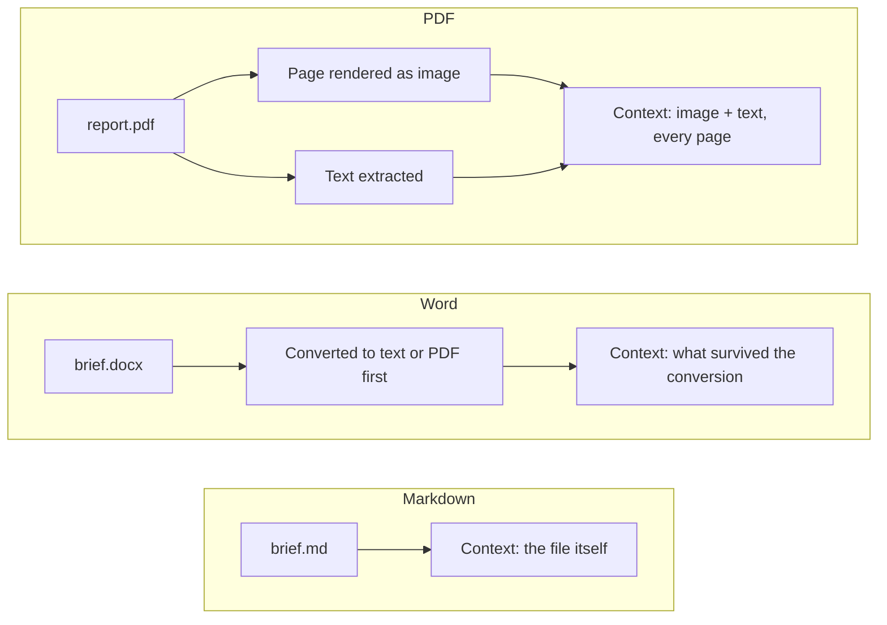
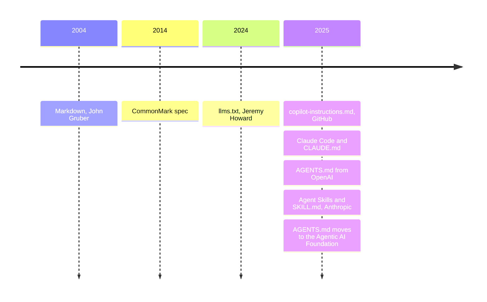
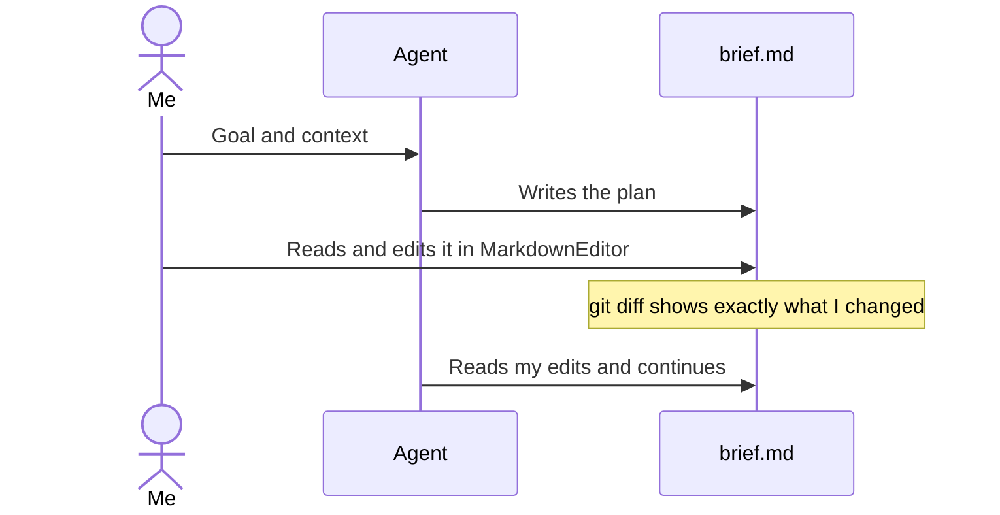

# Why I work in markdown

Most of what I hand to an AI agent ends up as a `.md` file, and so does most of what I get back: briefs, plans, research notes, reports. The README has the short version of why. This is the longer one, with the numbers behind it.

It doubles as a demo. Every chart and diagram below is written as text inside this file, so an agent reads and edits them the same way it reads the prose. Click **Redigér** on a block to see its source.

```html
<style>
  .kpis { display: grid; grid-template-columns: repeat(auto-fit, minmax(190px, 1fr)); gap: 12px; }
  .kpi { background: var(--color-card); border: 1px solid var(--color-border); border-radius: 10px; padding: 16px; }
  .kpi strong { display: block; font-size: 30px; line-height: 1.2; }
  .kpi strong.accent { color: var(--color-primary); }
  .kpi span { display: block; margin-top: 6px; color: var(--color-secondary-foreground); font-size: 14px; line-height: 1.4; }
</style>
<div class="kpis">
  <div class="kpi"><strong class="accent">80 %</strong><span>fewer tokens for Cloudflare's own blog post as markdown instead of HTML</span></div>
  <div class="kpi"><strong>~6x</strong><span>tokens when a model reads my raw work files instead of the same content in markdown</span></div>
  <div class="kpi"><strong>1,500–3,000</strong><span>text tokens per PDF page in the Claude API, before the page image is counted</span></div>
  <div class="kpi"><strong>60k+</strong><span>open-source projects with an AGENTS.md file</span></div>
</div>
```

## Every format has a price

A model doesn't read files. It reads tokens, and every tag, style attribute and page image is paid for in tokens before the model gets to the content.

Cloudflare measured it on their own announcement post: 16,180 tokens as HTML, 3,150 as markdown. It's one page picked by the vendor, so treat it as an example and not a benchmark. PDFs are worse. Anthropic's documentation says each page is turned into an image, with the extracted text sent alongside, and the text alone typically costs 1,500–3,000 tokens per page.

My own test points the same way. A batch of real work files (PDF, PowerPoint, Word, Excel) cost about 6x the tokens of the same knowledge in markdown, and 15–30x for slide decks heavy on images.

```html
<div style="position:relative;height:250px">
  <canvas id="cost"></canvas>
</div>
<script>
  const muted = mdTheme.mutedForeground
  new Chart(cost, {
    type: 'bar',
    data: {
      labels: ['Markdown', 'HTML (Cloudflare post)', 'Office files (my test)', 'Image-heavy decks (my test)'],
      datasets: [{
        label: 'Tokens relative to markdown',
        data: [1, 5.1, 6, [15, 30]],
        backgroundColor: [mdTheme.primary, muted, muted, muted],
        borderRadius: 4
      }]
    },
    options: {
      indexAxis: 'y',
      maintainAspectRatio: false,
      plugins: { legend: { display: false } },
      scales: { x: { title: { display: true, text: 'Tokens for the same content (markdown = 1)' } } }
    }
  })
</script>
```

## You pay on every read

The price isn't paid once. Agents re-read their working files all the time: when they plan, when they check their work, when you come back the next day. A heavy file costs the same on read twenty as on read one.

The chart below is an illustration, not a measurement. It assumes a 10-page brief as a PDF at roughly 3,500 tokens per page (2,000 for the text, from the middle of Anthropic's range, plus about 1,500 for the page image), and the same brief in markdown at a sixth of that, the ratio from my own test.

```html
<div style="position:relative;height:260px">
  <canvas id="readChart"></canvas>
</div>
<script>
  const reads = Array.from({ length: 20 }, (_, i) => i + 1)
  new Chart(readChart, {
    type: 'line',
    data: {
      labels: reads,
      datasets: [
        { label: 'Brief as markdown', data: reads.map(n => n * 5.8) },
        { label: 'Brief as PDF', data: reads.map(n => n * 35), borderColor: mdTheme.mutedForeground }
      ]
    },
    options: {
      maintainAspectRatio: false,
      scales: {
        x: { title: { display: true, text: 'Times the file is read' } },
        y: { title: { display: true, text: 'Tokens, thousands' } }
      }
    }
  })
</script>
```

After twenty reads that's roughly 700,000 tokens against 116,000. On a subscription it shows up as usage limits. On the API it shows up on the invoice.

## What the model actually receives

The difference is easiest to see in what happens before the model starts reading.



Claude's API doesn't take `.docx` or `.xlsx` as documents at all. Anthropic's docs tell you to convert them to plain text first, or to PDF if they contain images. Markdown skips the step entirely, because it already is plain text.

| Format  | What the model gets                                   | Readable as raw text | In a git diff |
| ------- | ----------------------------------------------------- | -------------------- | ------------- |
| `.md`   | The text, with headings and lists as plain characters | Yes                  | Line by line  |
| `.html` | Text wrapped in tags and attributes                   | Partly               | Noisy         |
| `.pdf`  | A page image plus extracted text, per page            | No                   | Binary        |
| `.docx` | Nothing until it's converted                          | No                   | Zipped XML    |

## Markdown became the agents' format

Nobody planned a standard. Each tool needed a place to put instructions that both people and models can read, and each of them ended up with a markdown file.



AGENTS.md alone is used by more than 60,000 open-source projects, according to its own site.

## One file, two readers

This is the part that changed how I work. The same file is the agent's workspace and my document. I don't export or copy anything back and forth.



Before this editor, that loop broke at step three. Raw markdown is fine for an agent and tiring for a person, so I would ask for a Word version, and then the agent and I were working on two different files.

## Where markdown loses

Markdown isn't the cheapest format for everything. For pure tables, a benchmark on multi-table question answering (TQA-Bench) found CSV more compact than markdown, and HTML at almost three times CSV.

```html
<div style="position:relative;height:200px">
  <canvas id="tables"></canvas>
</div>
<script>
  new Chart(tables, {
    type: 'bar',
    data: {
      labels: ['CSV', 'Markdown', 'HTML'],
      datasets: [{ label: 'Average tokens per database, 8K setting', data: [3730, 5400, 10500], borderRadius: 4,
        backgroundColor: [mdTheme.palette[1], mdTheme.primary, mdTheme.mutedForeground] }]
    },
    options: { indexAxis: 'y', maintainAspectRatio: false, plugins: { legend: { display: false } } }
  })
</script>
```

It also loses when layout is the point. A pitch deck for a client or something going to print still ends up in PowerPoint or InDesign. I just make it the last step: the thinking, the drafts and the back-and-forth with the agent happen in `.md`, and the layout version gets made from that.

## Sources

* Cloudflare, [Introducing Markdown for Agents](https://blog.cloudflare.com/markdown-for-agents/), 12 February 2026

* Anthropic, [PDF support](https://platform.claude.com/docs/en/build-with-claude/pdf-support) and [Files API](https://platform.claude.com/docs/en/build-with-claude/files)

* [AGENTS.md](https://agents.md/), and the Linux Foundation on the [Agentic AI Foundation](https://www.linuxfoundation.org/press/linux-foundation-announces-the-formation-of-the-agentic-ai-foundation)

* Jeremy Howard, [llms.txt](https://llmstxt.org/), September 2024

* John Gruber, [Introducing Markdown](https://daringfireball.net/2004/03/introducing_markdown), March 2004

* Anthropic, [Introducing Agent Skills](https://claude.com/blog/skills), October 2025

* [TQA-Bench: Evaluating LLMs for Multi-Table Question Answering](https://arxiv.org/abs/2411.19504), table VII

* My own token test of PDF, PowerPoint, Word and Excel files, described in the README

